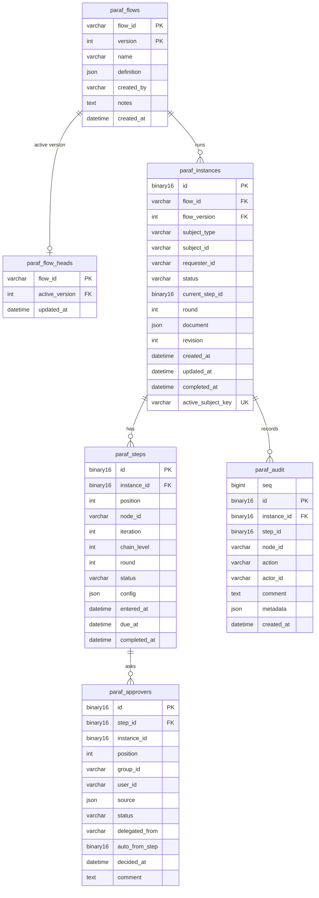

# @paraf/mysql

MySQL storage adapter for [Paraf](../../README.md).

> [!WARNING]
> Early development. The API may still change before `1.0.0`.

## Quick start

Requires Node.js 24+, `mysql2` 3.9+, and MySQL 8.0.19+ with InnoDB (tested on 8.4).

```sh
npm install @paraf/core @paraf/mysql mysql2
```

```ts
import { createEngine } from '@paraf/core';
import { MySqlStore } from '@paraf/mysql';
import mysql from 'mysql2/promise';

const store = new MySqlStore(mysql.createPool(process.env.DATABASE_URL));
await store.migrate(); // creates or upgrades the paraf_* tables; safe on every startup

const engine = createEngine({ store });
```

Use the same pool as the rest of your app if you like: Paraf only touches its own `paraf_*`
tables.

## Options and schema

- `new MySqlStore(pool, { tablePrefix })`: `tablePrefix` (default `paraf_`) changes every table
  and index name (lowercase letters, digits, `_`; at most 31 characters).
- `migrate()` runs under a named lock, so several app instances may start at once. MySQL commits
  DDL immediately, so a migration is not atomic; its statements are idempotent and a failed
  `migrate()` can simply be run again.
- Prefer managing the schema yourself? Apply [`schema.mysql.sql`](./schema.mysql.sql) (the same
  as `migrate()` with the default prefix); `migrate()` then finds nothing to do.
- IDs are stored as `BINARY(16)` and returned as UUID strings, so keep the engine's default
  UUID v7 IDs. Times are `DATETIME(3)` in UTC, whatever the pool's `timezone` setting.
- One running instance per subject is enforced by a unique `active_subject_key` column, which
  is `NULL` once the instance has finished.

## Tables

The same tables as [`@paraf/postgres`](../postgres/README.md#tables), with MySQL types:



Link your own tables through the subject. IDs are binary, so convert when you read them in SQL:

```sql
SELECT pr.*, i.status AS approval_status, BIN_TO_UUID(i.id) AS instance_id
FROM purchase_requests pr
LEFT JOIN paraf_instances i
  ON i.subject_type = 'purchase_request'
 AND i.subject_id = CAST(pr.id AS CHAR)
 AND i.status IN ('pending', 'in_progress', 'returned');
```
