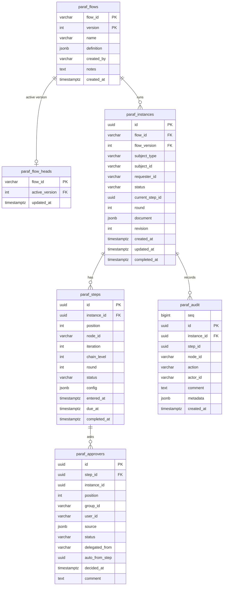

# @paraf/postgres

PostgreSQL storage adapter for [Paraf](../../README.md).

> [!WARNING]
> Early development. The API may still change before `1.0.0`.

## Quick start

Requires Node.js 24+, `pg` 8.11+, and PostgreSQL 12+ (tested on 16).

```sh
npm install @paraf/core @paraf/postgres pg
```

```ts
import { createEngine } from '@paraf/core';
import { PostgresStore } from '@paraf/postgres';
import { Pool } from 'pg';

const pool = new Pool({ connectionString: process.env.DATABASE_URL });
const store = new PostgresStore(pool);
await store.migrate(); // creates or upgrades the paraf_* tables; safe on every startup

const engine = createEngine({ store });
```

Use the same pool as the rest of your app if you like: Paraf only touches its own `paraf_*`
tables. See [`examples/express-postgres`](../../examples/express-postgres) for a complete API.

## Options and schema

- `new PostgresStore(pool, { tablePrefix })`: `tablePrefix` (default `paraf_`) changes every
  table and index name (lowercase letters, digits, `_`; at most 31 characters).
- `migrate()` applies pending migrations in one transaction, under an advisory lock, so several
  app instances may start at once. Applied migrations are recorded in `paraf_migrations`.
- Prefer managing the schema yourself? Apply [`schema.postgres.sql`](./schema.postgres.sql)
  (the same as `migrate()` with the default prefix); `migrate()` then finds nothing to do.
- IDs are stored as `UUID`, so keep the engine's default UUID v7 IDs.
- One running instance per subject is enforced by a partial unique index.

## Tables



| Table              | One row per                                                                                           |
| ------------------ | ----------------------------------------------------------------------------------------------------- |
| `paraf_flows`      | flow version (immutable): the definition as JSON, who published it, release notes                     |
| `paraf_flow_heads` | flow: which version new instances use                                                                 |
| `paraf_instances`  | approval of one of your records (`subject_type`, `subject_id`); `revision` guards concurrent updates  |
| `paraf_steps`      | step entered (per node visit, chain level, and resubmission round); `config` holds the resolved rules |
| `paraf_approvers`  | person asked in a group of a step, with their decision                                                |
| `paraf_audit`      | event of the audit trail, in order (`seq`)                                                            |

Your own tables link to Paraf through the subject, without foreign keys in either direction:

```sql
SELECT pr.*, i.status AS approval_status
FROM purchase_requests pr
LEFT JOIN paraf_instances i
  ON i.subject_type = 'purchase_request'
 AND i.subject_id = pr.id::text
 AND i.status IN ('pending', 'in_progress', 'returned');
```

`idx_paraf_appr_user_pending (user_id, status)` serves the inbox (`findPendingForUser`) and
`idx_paraf_steps_due (status, due_at)` serves `processTimeouts`.
